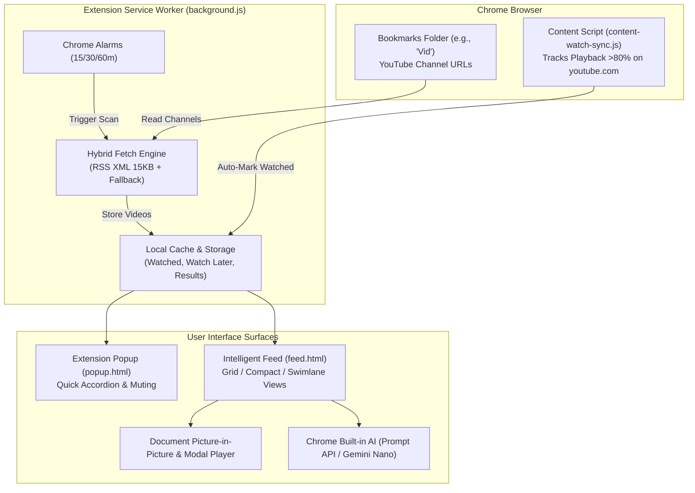

<div align="center">

# 📺 YouTube Channel Monitor
### The Privacy-First, Distraction-Free YouTube Aggregator & Intelligent Feed

[](https://developer.chrome.com/docs/extensions/mv3/intro/)
[](https://developer.chrome.com/docs/ai/built-in)
[](https://github.com)
[](LICENSE)

<p align="center">
  <b>Reclaim your YouTube experience.</b> Monitor only the creators you care about straight from your browser bookmarks, with zero algorithmic manipulation, moving WebP previews, multi-density feed layouts, bi-directional watch tracking, and local on-device AI summarization.
</p>

</div>

---

## ⚡ Why YouTube Channel Monitor?

The official YouTube homepage is engineered for addiction: infinite rabbit holes, engagement-driven recommendations, and Shorts clutter. 

**YouTube Channel Monitor** restores intentional consumption:
- 🚫 **Zero Algorithm**: Displays only new uploads from the channels you organize in your browser bookmarks.
- 🔑 **Zero API Quotas**: Operates without a Google Cloud API key, leveraging a hybrid RSS/Atom and Innertube engine.
- 🔒 **100% Private & Offline-First**: All metadata, watch states, and preferences reside solely on your device.
- 🧠 **On-Device AI Summaries**: Uses Chrome's built-in **Prompt API (Gemini Nano)** to summarize transcripts locally without sending data to external cloud LLMs.

---

## ✨ State-of-the-Art Features

### 1. 🎛️ Multi-Density Feed Layouts
Switch effortlessly between three presentation modes based on your workflow:
* **Standard Grid**: Beautiful 16:9 YouTube-style responsive cards with animated thumbnail previews.
* **Compact List (Triage Mode)**: Ultra-dense single-line layout for skimming 50+ video releases in seconds.
* **Channel Swimlanes**: Horizontal Netflix-style shelves grouping each creator's recent uploads into dedicated lanes.

### 2. 🚀 Ultra-Fast Hybrid Ingestion Engine
* **98% Bandwidth Savings**: Automatically discovers channel IDs and queries YouTube's public XML RSS endpoints (`~15KB`) instead of multi-megabyte HTML scraping.
* **Seamless Fallback**: Transparently queries Innertube/HTML if full durations or live stream metadata are required.

### 3. 🔄 Bi-Directional Watch Sync
* Features a lightweight background content script on `youtube.com/watch*`.
* When you watch a video on YouTube past 80% (or finish it), the extension **automatically marks it watched** across your feed and popup in real-time.

### 4. 🧠 On-Device AI Video Summarizer (TL;DW)
* Powered by Chrome's **Prompt API (Gemini Nano)**.
* Click the ✨ **AI Summary** button on any card to extract the video's transcript and generate:
  * 🎯 **Core Thesis**: 1 concise sentence summarizing the central premise.
  * 📌 **3 Key Highlights**: Structured takeaway bullet points.
  * 📋 **1-Click Copy**: Formatted markdown ready to paste into your notes.

### 5. 🎞️ Animated Moving Previews & In-Feed Document PiP
* **Hover WebP Scrubbing**: Hover over any thumbnail to preview moving animated frames (`mqdefault_6s.webp`).
* **In-Feed Modal Player**: Watch videos directly inside the feed without losing your place.
* **Chrome Document Picture-in-Picture**: Pop videos out into an always-on-top native floating window while continuing to browse your feed.

### 6. ⏱️ Precision Filtering & Content Slicers
* **Format Filters**: Hide Shorts, view Shorts only, or isolate active Live Streams.
* **Duration Slicers**: Filter by `Quick (< 5m)`, `Standard (5–20m)`, or `Deep Dive (> 20m)`.
* **Flexible Bookmarks Folder**: Monitors any bookmark folder you designate (defaults to `"Vid"`).

---

## 🏗️ System Architecture



---

## ⌨️ Keyboard Shortcuts

Speed through your feed like a pro:

| Key | Action |
| :---: | :--- |
| `j` / `↓` | Navigate to next video card |
| `k` / `↑` | Navigate to previous video card |
| `Enter` | Open selected video in designated tab mode |
| `p` | Play selected video in the in-feed modal player |
| `s` | Open ✨ **On-Device AI Video Summary** |
| `w` | Toggle selected video in **Watch Later** |
| `m` | Toggle selected video as **Watched / Unwatched** |
| `r` | Refresh feed and scan channels immediately |
| `/` | Focus search bar |
| `Esc` | Clear search / Close modal player & settings |

---

## 🚀 Quick Start & Installation

### Prerequisites
* Google Chrome (or any Chromium-based browser such as Brave, Edge, or Arc).
* *(Optional)* To enable Chrome's on-device Gemini Nano for instant AI summaries:
  1. Open `chrome://flags/#prompt-api-for-gemini-nano` in Chrome and set it to **Enabled**.
  2. Open `chrome://flags/#optimization-guide-on-device-model` and set it to **Enabled BypassPrefRequirement**.
  3. Relaunch Chrome.

### Installation
1. **Clone or Download this repository**:
   ```bash
   git clone https://github.com/your-username/youtube-channel-monitor.git
   ```
2. Open Chrome and navigate to `chrome://extensions/`.
3. Enable **Developer mode** via the toggle switch in the top right corner.
4. Click **Load unpacked** and select the `youtube-channel-monitor` directory.
5. In Chrome Bookmarks, create a folder named **`Vid`** (or specify your preferred folder name in the extension settings).
6. Bookmark any YouTube channel pages (e.g. `https://www.youtube.com/@Veritasium` or `https://www.youtube.com/@mkbhd`) into this folder.
7. Click the extension icon and select **Check Now** or open **Feed**!

---

## ⚙️ Configuration

Open **Settings** (gear icon in the topbar or popup) to configure:

* **Bookmark Folder**: Change the folder name being monitored (supports auto-suggestions from your Chrome bookmark tree).
* **Check Interval**: Automatic background polling frequency (`15 min`, `30 min`, `1 hour`).
* **Open Videos In**:
  * `Current Tab`
  * `New Tab`
  * `Background Tab`
  * `In-Feed Modal Player` (keeps you inside the feed).
* **Hide Watched Videos**: Automatically filter out videos you have already seen.
* **Desktop Notifications**: Receive native system alerts when tracked creators release new videos.

---

## 🔒 Privacy Guarantee

* **No Analytics**: Zero telemetry, tracking scripts, or analytics beacons.
* **No Cloud Relay**: Network traffic is strictly peer-to-peer between your browser and YouTube endpoints.
* **No Data Selling**: Your bookmark folders, watch history, and subscriptions never leave your local browser profile.

---

## 📄 License

Distributed under the **MIT License**. See [LICENSE](LICENSE) for more information.
